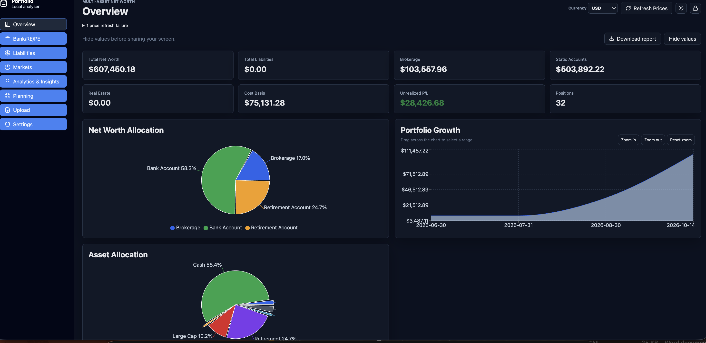
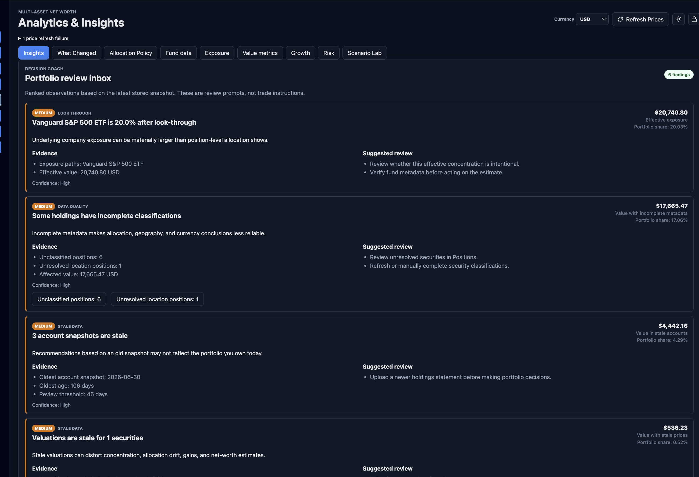
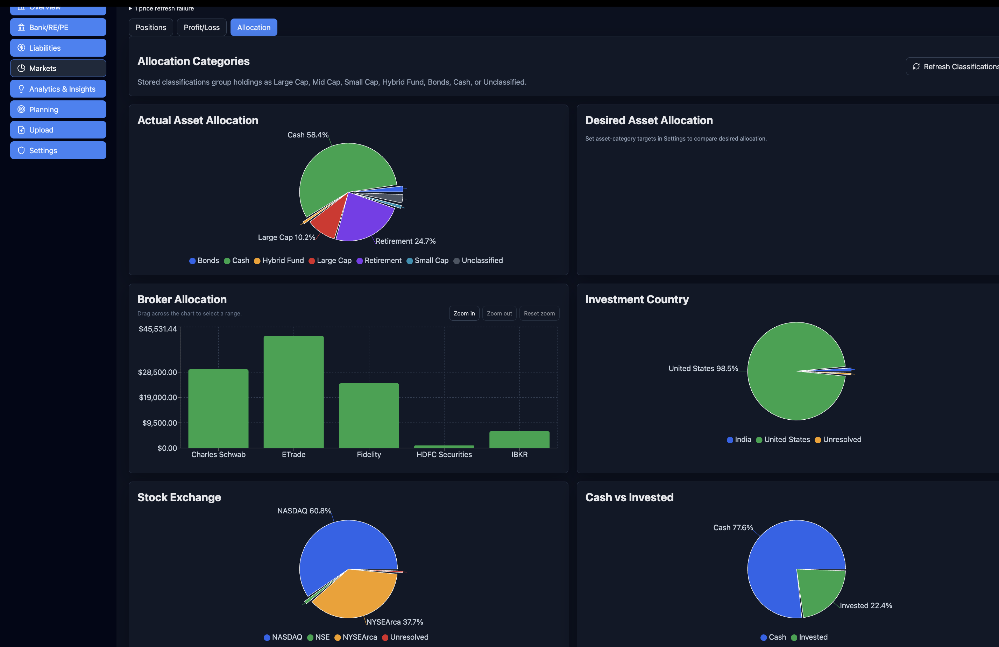
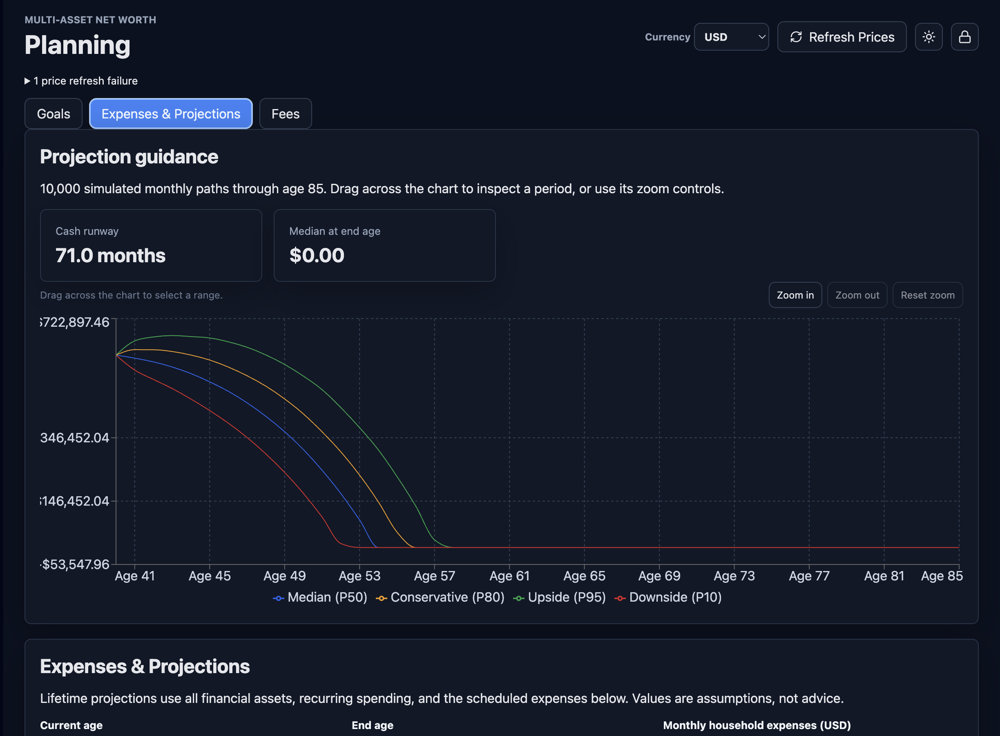

   [](https://github.com/sarun87/portfolio_analyser/actions/workflows/python-app.yml)   [](https://github.com/sarun87/portfolio_analyser/actions/workflows/node.js.yml)   [](https://github.com/sarun87/portfolio_analyser/actions/workflows/docker-image.yml)


This project is licensed under the GNU General Public License v3.0 only (GPL-3.0-only); see [LICENSE](LICENSE). It is provided without warranty. See the license for the complete terms.

# Portfolio Analyser

Local-first portfolio statement analyser for configurable CSV broker exports.






## What it does

- __Bring your finances together__: import brokerage CSV statements with reusable broker layouts, and track investments, bank and retirement accounts, real estate, private equity, and liabilities.
- __See the whole picture__: explore holdings, cost basis, gains and losses, allocation, portfolio growth, and household net worth over time. Compare snapshots to understand what changed.
- __Explore your portfolio__: review explainable insights and allocation-policy drift; examine fund holdings, look-through company exposure, overlap, fees, and potential cash drag.
- __Plan ahead__: set financial goals, model expenses and contributions, and explore lifetime projections based on 10,000 simulated paths. Compare saved scenarios and run portfolio stress tests.
- __Understand risk__: review volatility, beta, drawdowns, correlations, and holding-level risk contribution using refreshed or imported market history.
- __Share a polished snapshot__: generate a locally created PDF net-worth report—a one-page summary or a detailed report with an asset appendix—with your own title, logo, and footer.
- __Keep control of your data__: the portfolio database is encrypted at rest, and market-data refreshes are optional and user initiated. Public-data coverage and freshness limits are shown; provider availability and terms may change.

The application provides portfolio calculations and visualizations for informational purposes only. It is not financial, tax, or investment advice; verify values with your financial institution before making decisions.

## Run locally

Requirements: Python 3.9 or newer and Node.js 22 with npm. From the project directory, set up the environment and build the frontend once:

```bash
python3 -m venv .venv
source .venv/bin/activate
pip install -r backend/requirements.txt

cd frontend
npm install
npm run build
npm run dev
cd ..
```

The `run_portfolio_analyser` launcher script encompasses the workflow stated above. Run the app with the included launcher for development mode as below:

```bash
./run_portfolio_analyser
```

Then open `http://127.0.0.1:8000` in your browser. The launcher binds to your local machine by default.

## Run with Docker

Docker runs the application as an unprivileged process and bind-mounts `data/` and `logs/` from this directory, so portfolio data and outbound-request logs persist across container replacements.

```bash
./run_in_docker --build
```

To run a published release instead of building from source, pull and start the public GHCR image:

```bash
./run_in_docker --pull
```

To use a specific release tag, set `PORTFOLIO_DOCKER_IMAGE=ghcr.io/sarun87/portfolio_analyser:vX.Y.Z` before running with `--pull`. The first time the image is published, make the package public in GitHub Packages if it is not already visible publicly.

This makes the app available only on the local machine at `http://127.0.0.1:8000`. To allow access from the local LAN, explicitly opt into HTTP and name the exact URL opened in the browser:

```bash
PORTFOLIO_TRUSTED_ORIGINS=http://192.168.1.25:8000 ./run_in_docker --insecure
```

The Dockerfile builds natively on x86_64 and ARM64 hosts, including Apple Silicon and ARM Linux. To publish one image for both Linux architectures, use the `docker buildx` command documented at the top of `Dockerfile`.

For network-accessible production deployment with HTTPS, see [PRODUCTION_HTTPS.md](PRODUCTION_HTTPS.md).

<<<<<<< HEAD
## Notes

=======
<<<<<<< Updated upstream
=======
## Docker releases

Each `vMAJOR.MINOR.PATCH` GitHub Release publishes a multi-architecture Docker image for Linux/AMD64 and Linux/ARM64 to GHCR, tagged both with the release version and `latest`. GitHub Actions runs the backend and frontend tests before publishing. The GitHub Release includes generated release notes and the image reference; it does not include installer binaries. The first published GHCR package may need its visibility changed to **Public** in GitHub Packages.

Maintainers publish a release by pushing a semantic-version tag such as `v1.2.3`. To move a portfolio between installations, use Settings → Database Operations to export the selected data from the old app, then import it into the new one. Database exports are plain SQLite files; store them securely and delete them when no longer needed. GitHub provides source archives for each tag.

## Notes

>>>>>>> Stashed changes
>>>>>>> f1956d9 (Add release workflow to create and push images to ghcr repo)
Portfolio data exists as SQLite only in memory while the application is unlocked. Committed state is stored in `data/portfolio.db.encrypted` as a passphrase-encrypted container; no plaintext SQLite database or WAL is written to disk. `data/auth.json` contains only the random KDF salt and encrypted passphrase verifier.

The encrypted in-memory database is a single-process design. Run one Uvicorn worker; multiple workers would have separate in-memory copies of the portfolio. Multiple browser sessions are supported by the one process while the portfolio remains unlocked. Use the global lock action to revoke every session.

During development, the frontend can also run separately:

```bash
cd frontend
npm install
npm run dev
```

The frontend dev server expects the API at `http://127.0.0.1:8000`.

## Development and contributions

See [CONTRIBUTING.md](CONTRIBUTING.md) for environment setup, tests, and contribution guidance. Security issues should be reported privately as described in [SECURITY.md](SECURITY.md); participation is covered by the [Code of Conduct](CODE_OF_CONDUCT.md).
